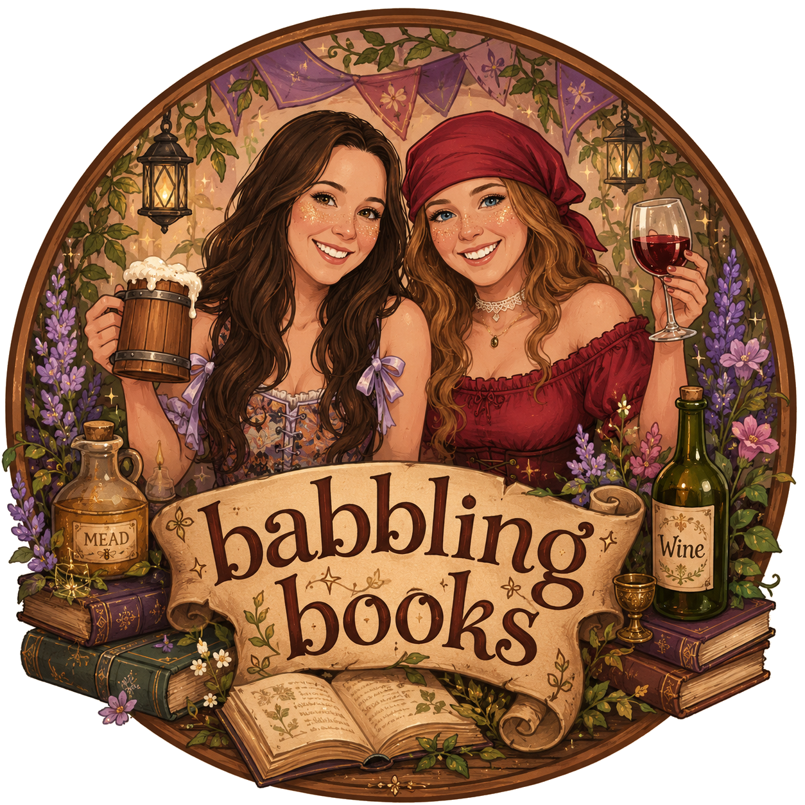

```{=html}
<section class="hero">
  <div class="hero__glow" aria-hidden="true"></div>
  
  <h1 class="hero__title">Two best friends.<br>One book.<br><em>So much babbling.</em></h1>
  <p class="hero__sub">A book club podcast with best friends Hannah and Patty. We read a few chapters at a time, then sit down and talk about everything that happened.</p>
  <span class="chip"><i class="bi bi-moon-stars-fill"></i> New episodes every Sunday · 9pm</span>
  <div class="hero__actions">
    <a class="btn btn--primary" href="https://open.spotify.com/show/033YEov0pxocKKkEwuywsy" target="_blank" rel="noopener"><i class="bi bi-spotify"></i> Listen on Spotify</a>
    <a class="btn btn--ghost" href="episodes.html"><i class="bi bi-collection-play"></i> Browse episodes</a>
  </div>
</section>
```

::: {#home}
:::

```{=html}
<section class="wrap block">
  <div class="block__head">
    <h2 class="block__title">Meet the hosts</h2>
  </div>
  <div class="hosts">
    <article class="host">
      <div class="host__badge" aria-hidden="true">H</div>
      <div>
        <h3 class="host__name">Hannah</h3>
        <span class="host__role">Co-host</span>
      </div>
    </article>
    <article class="host host--alt">
      <div class="host__badge" aria-hidden="true">P</div>
      <div>
        <h3 class="host__name">Patty</h3>
        <span class="host__role">Co-host</span>
      </div>
    </article>
  </div>
</section>
```

```{=html}
<section class="wrap block">
  <div class="tiktok">
    <div class="tiktok__bubble" aria-hidden="true">“you HAVE to read…”</div>
    <h2 class="tiktok__title">Pick our next read</h2>
    <p>Drop your book suggestions in the comments on our TikTok. Your pick could be next season's book!</p>
    <a class="btn btn--light" href="https://www.tiktok.com/@babblingbooksclip" target="_blank" rel="noopener"><i class="bi bi-tiktok"></i> @babblingbooksclip</a>
  </div>
  <p class="signoff">huzzah</p>
</section>
```
